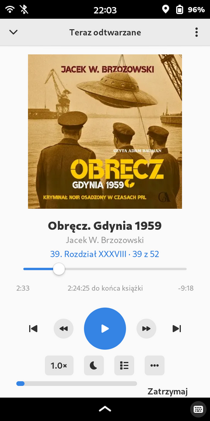

# Audiobooklet

A client for [Audiobookshelf](https://audiobookshelf.org/) servers, for Librem 5 / Phosh.
Offline-first, fast Rust native code, installable on PureOS Crimson as a deb.
For other Linux phones, Appimage and Flatpak builds are available.

 

## Features

*Offline-First* - first-class support for downloading audiobooks to local
storage, syncing progress after listening offline. Has both manually enabled
offline mode and network loss detection.

*Phone, not Gnome* - a mobile app, not a responsive desktop program. Pause
on call, handle headphones unplugging, battery efficiency, playback
notification. Tested on a real, slow phone. 

*Comfortable* - has playback speed, sleep timer, fast forward/rewind, search
and filtering.

*Fast* - native Rust code, no Javascript in sight. Low-memory setting for disabling
non-essential features and making it even faster.

*Accessible* - works with the Orca screen reader and a keyboard: every control is
named, play/pause and the seek slider speak their state, and each screen is
announced as it opens.

*Free Software* - GPLv3 licensed, only makes network calls to your Audiobookshelf
server

Audiobooklet is an independent project, not affiliated with the Audiobookshelf project.

### AI disclosure

The app has been developed using LLMs. 

Prompts by [GDR!](https://github.com/gjedeer/)

## Screenshots

Library Screen


Book Details


Chapter download options



Settings


Settings, in the light theme


## Thanks

Mr. 4551 for testing the initial versions and [operator](https://vis.social/@operator/117412571374748382) for the name suggestion

## Installing

### Installing the .deb via APT

The .deb files are currently built for PureOS Crimson, which is mostly the same 
as Debian Bookworm, x86_64 and aarch64.

Either use the repo as described below, or install .deb from Releases

```sh
sudo curl -fsSL https://gdr-aislop.github.io/audiobooklet/apt/audiobooklet.asc \
  -o /etc/apt/keyrings/audiobooklet.asc
echo "deb [signed-by=/etc/apt/keyrings/audiobooklet.asc] https://gdr-aislop.github.io/audiobooklet/apt stable main" \
  | sudo tee /etc/apt/sources.list.d/audiobooklet.list
sudo apt update
sudo apt install audiobooklet
```

### Verifying a standalone `.deb` or `.AppImage`

Every `.deb` and `.AppImage` attached to a [release](../../releases) also
gets a detached signature (`<file>.asc`), from the same key that signs the
Flatpak and APT repos — useful if you downloaded one directly rather than
through either repo (an `apt install` from the hosted repo above is already
verified via its own signed `Release`/`InRelease`, with nothing extra to do):

```sh
gpg --import audiobooklet-signing-key.asc   # once, also attached to every release
gpg --verify audiobooklet_<version>-1_<arch>.deb.asc audiobooklet_<version>-1_<arch>.deb        # amd64 / arm64
gpg --verify audiobooklet-<version>-<arch>.AppImage.asc audiobooklet-<version>-<arch>.AppImage  # x86_64 / aarch64
```

The signing key's fingerprint is:

```
CC77 E444 A5CD 5384 0459  1237 08D0 546C 9455 D910
```

Check it against `gpg --fingerprint` after importing `audiobooklet-signing-key.asc`, since that
file is hosted alongside the binaries it verifies and shouldn't be the only
source trusted for the key itself.

### Building from source

To build just the `audiobooklet` binary — on PureOS Crimson / Debian, or on Alpine /
postmarketOS — see [BUILD.md](BUILD.md).

### Building an AppImage manually

```sh
# Inside a Debian-family system with the dev + runtime packages installed:
./scripts/build-appimage.sh                       # x86_64, version from git
./scripts/build-appimage.sh --arch aarch64 --version 0.1.0

# Anywhere, via a Debian bookworm container (docker or podman):
./scripts/build-appimage-in-docker.sh

# aarch64 AppImage on an x86_64 host (arm64 container under QEMU emulation):
./scripts/build-aarch64-appimage-on-x86.sh
```

Output lands in `build/appimage/audiobooklet-<version>-<arch>.AppImage`.
`scripts/build-appimage.sh --help` documents environment overrides
(`ABS_APP_BIN`, `LINUXDEPLOY`, `APPIMAGE_TOOLS_DIR`); the docker wrapper
mirrors the CI job's package set via `scripts/appimage-builder-bookworm.Dockerfile`.

### Installing the Flatpak

The recommended way — adds a remote once, then `flatpak update` picks up
every new tagged release automatically:

```sh
flatpak remote-add --user --if-not-exists audiobooklet \
  https://gdr-aislop.github.io/audiobooklet/io.github.gdr_aislop.audiobooklet.flatpakrepo
flatpak install --user audiobooklet io.github.gdr_aislop.audiobooklet
```

Alternatively, download the `.flatpak` file from a
[release](../../releases) and install it directly, with no remote added:

```sh
flatpak install --user ./audiobooklet-<version>-<arch>.flatpak   # <arch>: x86_64 or aarch64
```


## Reporting problems

For non-crashes, there's a "Show logs" button in Settings, which will open a text editor
with the latest log file in it. Please attach this log to your bug report. The files
are in  `~/.local/state/io.github.gdr_aislop.audiobooklet/`

For crashes, there's `~/.local/state/io.github.gdr_aislop.audiobooklet/crashes/crash-<timestamp>-<pid>.dmp`
which can be processed with [`minidump-stackwalk`](https://crates.io/crates/minidump-stackwalk)
if you feel like solving it yourself.

Try to reproduce the bug before reporting, and describe the steps.
